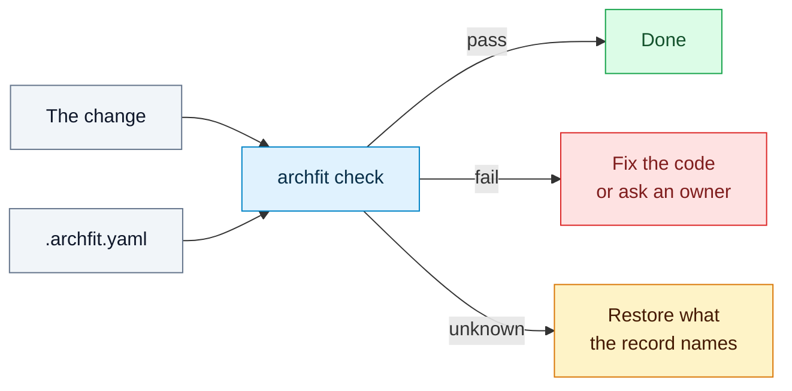

# archfit

[](https://github.com/alexei-led/archfit/actions/workflows/ci.yaml)
[](https://github.com/alexei-led/archfit/tags)
[](LICENSE)

**archfit checks whether code changes follow the architecture declared for a repository.**

Tests can pass while a change adds a forbidden dependency, a new cycle, or a copy of code another module owns. archfit reads the imports and literals of the change, applies the rules of your policy, `.archfit.yaml`, and gives the change one status: `pass`, `fail`, or `unknown`. Use the same check locally, in agent hooks, and in continuous integration (CI).

```text
$ archfit check
pkg/tc/netem.go:12: graph: pkg_tc -> pkg_util is not an allowed dependency
  why: a new dependency between modules needs an owner
  balance: 9/10 (min 7)
  next: archfit request -m "<why you need it>"     (do not copy the code)
archfit: fail, 1 error
```

Each error says where, which rule, and what is wrong; then why, what to do instead, and the next step. The status line comes after the errors.

## How it works



The check compares the change with its target branch and lists only the errors the change adds. An error that existed before is the owners' work, not the work of an unrelated change.

## Install and start

Install the CLI with Homebrew:

```sh
brew install alexei-led/tap/archfit
```

Or install a tagged release with Go:

```sh
go install github.com/alexei-led/archfit/v3/cmd/archfit@v3.2.0
```

Run these commands from your repository:

```sh
archfit doctor --fix          # this checkout: the tools archfit needs, and the hooks
archfit init                  # write .archfit.yaml and the block for agents
archfit rules                 # the rules for the files you change
archfit can pkg/tc pkg/util   # before a new dependency between modules
archfit check                 # the change: pass, fail, or unknown
archfit request -m "<why>"    # when a rule is in your way: ask an owner
archfit report                # for owners: the state of the repository
```

Read the policy `init` writes, then open a pull request with it. Run `archfit check` in CI. See [Getting started](docs/getting-started.md).

The Docker image includes Node, Python, Rust, the .NET SDK, ast-grep, jscpd, cargo-modules, and the Roslyn helper (`archfit-roslyn`). Go is build-only. Deeper analyzers remain configuration-controlled. See [Getting started](docs/getting-started.md#use-docker) for details.

## Documentation

- [Getting started](docs/getting-started.md) — set up a repository and run your first check.
- [Commands](docs/commands.md) — command behavior, flags, and exit codes.
- [Configuration](docs/configuration.md) — every policy field and default.
- [Rules](docs/rules.md) — built-in rules, custom rules, and exceptions.
- [Results](docs/results.md) — the record, the statuses, JSON, and SARIF.
- [Metrics](docs/metrics.md) and [coupling](docs/coupling.md) — what the measurements mean.
- [Language support](docs/languages.md) — analyzers, tools, and coverage.
- [CI](docs/ci.md) and [agents](docs/agents.md) — automation workflows.
- [Troubleshooting](docs/troubleshooting.md) — common errors and recovery.
- [Migration](docs/migration.md) — upgrade from Archfit 3 to 4. [Archfit 2 to 3](docs/archived/migration-v2-to-v3.md).
- [Architecture](docs/architecture.md) and [evidence](docs/evidence.md) — contributor references.
- [Development](CONTRIBUTING.md) — build and change the project.
- [Changelog](CHANGELOG.md) — release history.
