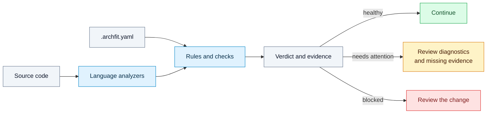

# archfit

[](https://github.com/alexei-led/archfit/actions/workflows/ci.yaml)
[](https://github.com/alexei-led/archfit/tags)
[](LICENSE)

**archfit checks whether code changes follow the architecture declared for a repository.**

Tests can pass while a change adds a forbidden dependency or a new cycle. archfit reads dependency facts from language tools, applies your rules, and reports a verdict with evidence. Use the same check locally and in continuous integration (CI).

The report shows measured evidence and evidence gaps. It does not reduce the repository to one score.

```text
archfit check

VERDICT    NEEDS ATTENTION
BLOCKING   0 active
ATTENTION  diagnostics or incomplete evidence
```

The lines above show the report shape. Counts and verdicts depend on your repository.

## How it works



The report labels each outcome. Green means healthy, amber means needs attention, and red means blocked.

## Install and start

Install the CLI with Homebrew:

```sh
brew install alexei-led/tap/archfit
```

Or install a tagged release with Go:

```sh
go install github.com/alexei-led/archfit/v3/cmd/archfit@v3.1.0
```

Run these commands from your repository root:

```sh
archfit doctor
archfit config init --root .
archfit analyze -c .archfit.yaml
```

Review the generated module paths and rules before you use the configuration as policy. Create a baseline only after you review the findings. Run `archfit check` in CI.

The Docker image includes Go, Node.js, Python, dependency-cruiser, and ast-grep tools. It does not include Rust tools. See [Getting started](docs/getting-started.md#use-docker) for details.

## Documentation

- [Getting started](docs/getting-started.md) — install tools and run your first check.
- [Commands](docs/commands.md) — command behavior, flags, and exit codes.
- [Configuration](docs/configuration.md) — every configuration field and default.
- [Rules](docs/rules.md) — rule types, selectors, and waivers.
- [Results](docs/results.md) — verdicts and output schemas.
- [Metrics](docs/metrics.md) and [coupling](docs/coupling.md) — what the measurements mean.
- [Language support](docs/languages.md) — analyzers, tools, and coverage.
- [CI](docs/ci.md), [agents](docs/agents.md), and [AI](docs/ai.md) — automation workflows.
- [Troubleshooting](docs/troubleshooting.md) — common errors and recovery.
- [Migration](docs/migration.md) — upgrade from v2 to v3.
- [Architecture](docs/architecture.md) and [evidence](docs/evidence.md) — contributor references.
- [Development](CONTRIBUTING.md) — build and change the project.
- [Changelog](CHANGELOG.md) — release history.
