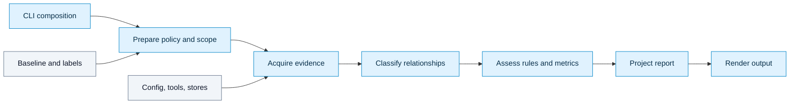

# Architecture

Archfit is a Go command-line tool. Its six layers keep policy, analysis, workflow, and system integrations in separate places.

## Layers and ownership

| Layer | Responsibility | Main packages |
|---|---|---|
| `model` | Neutral evidence and report contracts | `internal/model/**`, `internal/evidence`, `internal/report/ports` |
| `support` | Shared analysis scope | `internal/scope` |
| `core` | Policy, relationships, assessment, syntax analysis | `internal/policy`, `internal/relationship/**`, `internal/assessment/**`, `internal/syntax` |
| `application` | Use-case stages and report projection | `internal/application` |
| `adapter` | Config, acquisition, tools, persistence, providers, output | `internal/config`, `internal/evidence/acquisition`, `internal/extract/**`, `internal/toolrun`, `internal/factcache`, `internal/history`, `internal/baseline`, `internal/ownership`, `internal/labels`, `internal/llm`, `internal/output/**` |
| `cmd` | CLI composition, development tools, architecture tests | `cmd/**`, `internal/calibrate`, `scripts/eval`, architecture tests |

The module map and import limits live in `.archfit.yaml`. See `AGENTS.md` for the generated module table and blocking rules.

## Run flow

The application owns the stage order. Acquisition returns observations. Relationship analysis turns graph evidence into a classified relationship set. Assessment evaluates policy and evidence. Projection maps internal results to the report contract. Renderers consume that contract.

## Dependency rules

- Dependencies point from outer layers to inner layers.
- Core packages do not import command or adapter implementations.
- Application code uses ports. It does not import concrete extractors, output adapters, or persistence adapters.
- Relationship analysis owns classification and coupling semantics. Assessment consumes its public relationship contract.
- Assessment does not read the raw graph or relationship classifier internals.
- Renderers consume report DTOs. They do not make policy or assessment decisions.
- CLI packages wire concrete implementations. They do not implement domain rules, metrics, or decisions.
- Neutral model packages do not import project packages.

`archfit check` enforces configured module and layer boundaries. Go architecture tests enforce additional import rules and report-surface stability. After a boundary change, run `go test ./internal/ -run 'TestArchImports|TestAssessmentProductionDoesNotImportRawGraphOrCoupling|TestAssessmentConsumesOnlyThePublicRelationshipContract|TestReportProjectionHasOneOwner'` and `go test ./internal/ -run TestModelSurfaceNoDrift`. Then run `archfit check`. See [development](../CONTRIBUTING.md) for the full local check sequence.

## Change guide

| Change | Owner |
|---|---|
| Add policy syntax or boundary semantics | `internal/policy` and config adapters |
| Add source or tool observations | Evidence contracts, then the relevant acquisition adapter |
| Change relationship classification or coupling | `internal/relationship` |
| Change findings, metrics, verdicts, or repair tasks | `internal/assessment` |
| Change command workflow or stage order | `internal/application` |
| Change public report fields | `internal/model/report` and its schema |
| Change rendering | `internal/output/**` |
| Change flags or concrete wiring | `cmd/archfit` |

Keep decisions with their domain owner. Add a port when an inner layer needs an outer-layer service. Ask `archfit policy can-import` before adding a cross-module import.

## Accepted boundaries

`internal/extract/ts`, `internal/extract/py`, and `internal/extract/dotnet` use strength constants from `internal/relationship/coupling`. They emit vocabulary only. They do not classify or score relationships. If an extractor needs classification behavior, move the shared value to a neutral model package first.

The report projection sits in the application layer because it maps domain results to the report contract. It has a restricted import rule so it cannot reach into relationship or evidence internals.

Configuration update and enrichment use restricted CLI adapters to translate authoring results.
The exception register is `cmdDomainAdapterFiles` in `internal/arch_test.go`.
These adapters can run an authoring pipeline. Command stages still enter through application use cases.

The evidence adapter and persistence adapter modules have a declared module cycle through shared adapter responsibilities. The self-check reports this cycle as a warning. Keep core and application dependencies pointed inward.

## Contracts to preserve

The Go tests enforce additional contracts that are not visible in the layer table.
Update the matching tests when a contract changes.

| Contract | Owner and check |
|---|---|
| Policy purity | `internal/policy` owns policy contracts. It may use the model kernel and the approved pure matcher. The `policy_owns_domain_contracts` subtest in `TestArchImports` checks its imports. |
| Projected configuration | Stages receive their own option contracts. They do not receive `internal/config`. `internal/config` projects options for each consumer. `TestPolicyDoesNotImportConfig` and module rules enforce the boundary. |
| Relationship and assessment | `internal/relationship` owns classification and coupling. Assessment consumes its public contract. `TestAssessmentConsumesOnlyThePublicRelationshipContract` checks this rule. |
| Report projection | `internal/application` maps results to report DTOs. The projector does not import relationship or evidence internals. `TestReportProjectionHasOneOwner` checks this rule. |
| Model surface | `internal/model` is a published contract. `TestModelSurfaceNoDrift` checks `internal/testdata/model_surface.golden`. See [development](development.md) before changing it. |
| Tool boundaries | Go and Rust tools run through adapters and `toolrun.Runner`. Core code does not start subprocesses. `TestArchImports` checks the import boundary. |

The .NET Roslyn helper is an adapter artifact built from `tools/dotnet/archfit-roslyn`. The Go side starts it through `toolrun.Runner` and reads its JSON. It is not a core dependency. `internal/extract/dotnet` emits strength hints only; `internal/relationship` classifies.

Rust extraction first reports crate-level facts. Optional module and SCIP analyzers add intra-crate evidence. See [evidence](evidence.md) for evidence limits. See [languages](languages.md) for analyzer setup.

## Coupling boundary

In bc_score.v7, each cross-module boundary has distance D=9. Owner and deploy-unit data describe the boundary and contribute to resolved model identity. They do not change distance, severity, or distributed-monolith qualification. The [coupling reference](coupling.md) owns the scoring rules.
